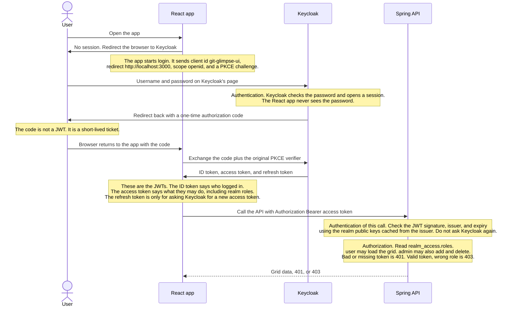

# Keycloak

Keycloak is an open-source IAM (identity and access management) server. 
- Applications send users to Keycloak to sign in. 
- Keycloak checks the password, or an external directory, and gives the application tokens. 
- The application uses those tokens to decide who the caller is and what that caller is allowed to do.

Keycloak implements either **OpenID Connect** (which runs on top of **OAuth 2.0**) or **SAML 2.0**.
- [OAuth 2.0](https://oauth.net/2/) (Delegated Authorization)
  - It is an authorization (what you can access) framework, not an authentication protocol. 
  - Allows a third-party app to access a user's resources without ever receiving that user's password or revealing the user's identity.
  - Key components are access token, scopes (permission) and refresh token.
- [OpenID Connect](https://openid.net/connect/) (OIDC, Modern Authentication)
  - It is an identity layer on top of OAuth 2.0; it adds proof of who is logging in.
  - It adds an *ID token* and a *standard way* to read the signed-in user's profile.
  - **ID Token**: A signed JWT containing user identity claims (such as user ID, email, name).
  - **UserInfo Endpoint**: A standard API URL where the app can use its access token to fetch extra profile details.
  - **Standard Scopes**: Introduces the mandatory OpenID scope (alongside profile and email) to trigger identity issuance.
  - Developers prefer it because it's a Lightweight JSON/REST structure that works natively across web browsers, mobile apps, and single-page applications (SPAs).
- [SAML 2.0](https://docs.oasis-open.org/security/saml/Post2.0/sstc-saml-tech-overview-2.0.html) 
  - It is an older XML protocol for exchanging login proof between an identity provider and an application. 
  - Heavyweight, XML-based, and built specifically for browser-based corporate logins.
  - Enables Single Sign-On (SSO) across separate domains so an employee logs into one corporate portal and automatically gets into other company portals.
  - It predates OpenID Connect and OAuth 2.0.

This project would use **OpenID Connect**: the React app signs the user in, and the Spring Boot API checks the access token.

## Ideal flow in this application

This is not wired up yet. The login is the OAuth 2.0 authorization-code flow. OpenID Connect adds the ID token on that flow. [PKCE](https://oauth.net/2/pkce/) (Proof Key for Code Exchange) is an extra check on the same code exchange, not a separate login. The React app starts login. Keycloak is the only place that checks the password and mints the JWTs. The API only checks the access-token JWT.

PKCE matters because the React app is a public client and cannot keep a client secret. Before the redirect, the app makes a random verifier and sends only its hash, the code challenge. The authorization code comes back through the browser. When the app exchanges that code, it sends the original verifier. Keycloak hashes the verifier and accepts the exchange only when the hash matches the challenge. A stolen code is useless without the verifier, which never left the app.



## What Keycloak is responsible for

Keycloak is aimed at identity, authentication, and authorization.

| Concern | Keycloak's job | This application's job |
| --- | --- | --- |
| Identity | Stores the login account, or links it to an outside directory. Holds the username, email, and credentials. | Stores GitHub user rows. Those rows are not Keycloak users. |
| Authentication | Proves who is calling. Checks the password, a second factor, or an external login. Issues the ID token and the access token. | Trusts a token only after the signature, issuer, and expiry check. A failed check is HTTP 401. The API does not show a login form. |
| Authorization | Records which roles and scopes a user has, and copies them into the access token. Optional Authorization Services can also answer "may this user do this action on this resource?" | Reads those roles and allows or refuses each endpoint. A valid token with the wrong role is HTTP 403. |

**Authentication** answers "who is this?". Keycloak is the component that collects the proof. The proof can be a password, a one-time code, a passkey, or a login brokered from Google, SAML, or LDAP. After that proof succeeds, Keycloak starts a session and issues tokens. The React app and the API never see the password.

**Authorization** answers "what may this caller do?". Keycloak supports two levels:

- **Roles and scopes in the token.** Keycloak assigns `user` and `admin`. The access token carries them. Spring Security enforces them with `hasRole` and `@PreAuthorize`. This is the level planned for Git Glimpse. Keycloak decides membership. The API decides which endpoint requires which role.
- **Authorization Services.** A separate Keycloak feature. An application registers resources and scopes, then policies such as "only the owner" or "only between 09:00 and 17:00". The API asks Keycloak for a decision, or Keycloak embeds the permissions in a token. This project does not use that feature. Endpoint roles are enough.

Keycloak also covers the surrounding identity jobs:

- **Single sign-on and logout.** One login session is shared by every client in the realm.
- **Federation and brokering.** Users can live in Active Directory, LDAP, or another identity provider. Keycloak still issues the tokens the API sees.
- **Client authentication.** A confidential client proves it is the application, using a client secret or a signed JWT. That is authentication of the app, not of a person.
- **Login hardening.** Brute-force lockout, required actions such as "update password", and step-up authentication when a sensitive action needs a fresh proof.

Keycloak does not replace these:

- Business rules that depend on the data, such as "a person may edit only the record they created." The API checks that against MariaDB.
- Network controls, rate limits, and database account permissions.
- The GitHub personal access token this API uses when it calls `api.github.com`.

## How a login works

The diagram above is this same path in words. The browser, the React app, Keycloak, and the API each do a different job. The React app never receives the user's password.

1. The user opens the React app.
2. The app redirects the browser to Keycloak's login page for a realm and a client. The redirect includes a Proof Key for Code Exchange (PKCE) challenge so a stolen authorization code is not enough to get tokens.
3. The user types a username and password on Keycloak's page. Keycloak can instead delegate that check to Google, a company login, or an LDAP directory.
4. Keycloak redirects the browser back to the app with a short-lived authorization code.
5. The app exchanges that code, plus the PKCE verifier, for three tokens: an ID token, an access token, and a refresh token.
6. The app calls the API with `Authorization: Bearer <access token>`.
7. The API downloads the realm's public keys from the issuer and checks the token's signature, issuer, and expiry. It then reads the roles inside the token and allows or refuses the request.

The API does not call Keycloak on every request. After the public keys are cached, checking a token is a local signature and claims check.

## Tokens

| Token | What it is |
| --- | --- |
| ID token | OpenID Connect token that says who logged in. The app uses it for the username shown on screen. It is not the credential sent to the API. |
| Access token | OAuth 2.0 token the app sends to the API. In this setup it is a signed JSON Web Token (JWT). It carries the user id, expiry, and roles. |
| Refresh token | Longer-lived token used to get a new access token without showing the login page again. The API does not accept it as a request credential. |

A JWT has three parts: a header, a payload of claims, and a signature. Claims are named fields inside the payload, such as `iss` (who issued it), `exp` (when it expires), `preferred_username`, and `realm_access.roles`.

## Terminologies

**Identity and access management (IAM).** The system that stores users and decides which applications they can use.

**Realm.** A Keycloak tenant. One realm has its own users, roles, clients, and login settings. Two realms do not share users. This project's issuer is the realm `myrealm` at `http://localhost:8080/realms/myrealm`.

**User.** A person or a service account that can authenticate. A user has credentials and is assigned roles.

**Credential.** The secret used to prove identity. A password is one kind. A one-time code and a client secret are others.

**Client.** An application registered in a realm. The React app is one client. A backend that signs in on its own would be another. "Client" here does not mean the HTTP caller of the API.

**Public client.** A client that cannot keep a secret, such as a browser app. It uses the authorization code flow with PKCE and has no client secret.

**Confidential client.** A client that runs on a server and can store a client secret. The secret authenticates the application to Keycloak. It is not a user's password.

**Redirect URI.** An address Keycloak is allowed to send the browser back to after login. Anything else is rejected.

**Web origin.** A browser origin (scheme, host, and port) that Keycloak allows to start a login. `http://localhost:3000` is the React dev server.

**OpenID Connect (OIDC).** An identity layer on top of OAuth 2.0. It adds the ID token and a standard place to read the user's profile.

**OAuth 2.0.** A protocol for granting an application limited access. It does not, by itself, say who the user is. OpenID Connect adds that.

**Authorization code flow.** The login sequence above. The browser brings back a code. The app trades the code for tokens.

**PKCE.** A bind between the login request and the token request. The app creates a random verifier, sends a hash of it when the login starts, and sends the verifier again when exchanging the code. This is the current flow for browser apps.

**Authorization server.** The server that logs the user in and issues tokens. Keycloak is this server.

**Resource server.** The API that receives the access token and protects data. `app-backend` is the resource server. It validates tokens. It does not show the login page.

**Issuer.** The realm URL stamped into the token as `iss`. The API trusts tokens only from the configured issuer.

**JWKS.** The set of public keys published by the realm. The API uses them to verify the token signature. The matching private key stays on Keycloak.

**Scope.** A requested slice of access, such as `openid`, `profile`, or `email`. Scopes decide which profile claims are included. They are not the same thing as an application role.

**Realm role.** A role defined once in the realm and assigned to users. Keycloak puts these in the access token under `realm_access.roles`. The planned roles `user` and `admin` are realm roles.

**Client role.** A role that belongs to one client. Keycloak puts it under `resource_access.<client>.roles`. Use a client role when the permission should exist only for that one application.

**Composite role.** A role that contains other roles. Assigning the composite role assigns all of the roles inside it.

**Group.** A set of users. Roles can be attached to the group, and every member inherits them. Groups organize people. Roles are what the API checks.

**Protocol mapper.** A realm setting that copies a user attribute, group, or role into a token claim. Realm roles appear in the token because a mapper writes them there.

**Identity provider.** Another login system connected to the realm, such as Google, GitHub, or a company's SAML login. Keycloak brokers that login and still issues its own tokens to the app.

**User federation.** A read of users from an external store, usually LDAP or Active Directory, instead of creating each user inside Keycloak.

**Session.** Keycloak's record that this browser is logged in. Ending the session logs the user out of applications that share it.

**Single sign-on (SSO).** One login at Keycloak is accepted by every application in the realm. Signing in to a second app skips the password page while the session is valid.

**Single logout.** Ending the Keycloak session notifies the applications to drop their local login too.

**Service account.** A client that logs in as itself with the client-credentials grant. No person is involved. Jobs and other APIs use this.

**Keycloak admin roles.** Roles such as `realm-admin` and `manage-users` that control the Keycloak console. They are not application permissions. An application `admin` role does not grant access to the Keycloak admin console.

## What the API checks

A valid signature is not the same thing as permission.

1. **Authentication.** The token is signed by the realm, is not expired, and the issuer matches. Failure is HTTP 401.
2. **Authorization.** The token's roles include the role required by that endpoint. Failure is HTTP 403.

Spring Security's `hasRole("admin")` looks for the authority `ROLE_admin`. Keycloak stores the role as `admin` inside `realm_access.roles`. The API has to map that claim onto `ROLE_admin`. Spring's default converter reads the OAuth `scope` claim, not Keycloak's nested realm roles.

## Common production roles

Application roles name jobs, not Keycloak console access. Small systems often use only these:

| Role | Typical permission |
| --- | --- |
| `user` or `member` | Read and use the product as themselves. |
| `admin` | Manage other users' records and settings. |
| `support` | Read records and perform a few support actions, without full admin write access. |
| `auditor` or `readonly` | Read data and audit logs. No create, update, or delete. |
| `billing` | Invoices and subscriptions only. |
| `service` | A machine identity for one job, not a person who can open the UI. |

Larger systems split `admin` into smaller roles: `user-admin`, `content-admin`, and `security-admin`. A composite `admin` role can contain those when one person should still have all of them.

Assign the least role that covers the job. Give an administrator both `admin` and `user` when the read endpoints require `user`, so an admin can still open the screens they manage.

## Common production use cases

**Browser app and API.** The React app is a public client. The API is a resource server. People sign in through Keycloak. This is the shape planned for Git Glimpse.

**Single sign-on.** Several internal tools share one realm. A person logs in once and moves between the tools.

**Employee directory.** User federation reads staff from Active Directory or LDAP. The applications still see Keycloak tokens.

**Customer social login.** A customer uses Google or another identity provider. Keycloak links that identity to a local user and issues the application's roles.

**Service-to-service calls.** A backend job uses a confidential client and the client-credentials grant. The token has a service role, not a person's role.

**Partner or multi-tenant access.** Each customer gets a realm, or one realm uses groups so a person is an admin of one tenant and a user of another.

**Step-up authentication.** A normal session can read data. A sensitive action asks Keycloak for a fresh login or a second factor before the API accepts it.

## How Spring Boot configures Keycloak

`app-backend` already depends on `spring-boot-starter-security`, `spring-boot-starter-oauth2-resource-server`, and `spring-security-oauth2-jose`. Those libraries validate a bearer JWT. They do not render Keycloak's login page. The React app is the public client that performs the login. The API is only the resource server.

Two different Keycloak settings are easy to mix up in `application.yml`:

| Setting | Property | What it configures |
| --- | --- | --- |
| Resource server | `spring.security.oauth2.resourceserver.jwt.issuer-uri` | This API accepts access tokens from that realm. This is the setting the grid needs. |
| OAuth2 client | `spring.security.oauth2.client.registration.keycloak` | A confidential client (`backend-api`) that would log a user in through this Spring app itself, using an authorization code and a client secret. The React app does not use this registration. |

The issuer value is `http://localhost:8080/realms/myrealm`. At startup Spring loads `/.well-known/openid-configuration` from that URL, then the realm's JWKS. A token is accepted only when its `iss` claim is that URL, its signature matches a published key, and it has not expired.

### Security filter chain

A `SecurityFilterChain` is the ordered set of rules Spring Security applies to each HTTP request. `SecurityConfig` currently publishes two chains, chosen with `@Profile`:

- **Profile `local`.** The profile used for development (`spring.profiles.active=local`). This chain permits every request and disables CSRF. The grid works with no Keycloak token. The plan removes this open chain.
- **Any other profile.** This chain requires an authenticated caller, and it requires role `user` for every path under `/api/github/**`. It attaches the resource server with `oauth2ResourceServer().jwt()`.

The plan uses one chain for every profile, including `local`:

- **Stateless session.** `SessionCreationPolicy.STATELESS`. Spring does not create an HTTP session or a session cookie. Each request is authenticated only by the access token it carries.
- **CSRF disabled.** Cross-site request forgery protection expects a CSRF token on a browser POST or DELETE that uses a session cookie. This SPA sends a bearer token through the dev server proxy and has no session cookie, so there is no CSRF token to send. The bearer token is the credential instead.
- **Open paths.** `GET /actuator/health`, Swagger, and `/api-docs` stay `permitAll`, so a health check and the API docs do not need a user token.
- **Read paths.** `GET /api/github/user/*` and `POST /api/github/fetch` use `hasAnyRole("user", "admin")`. A caller with either role can look up a user and load a grid page.
- **Write paths.** `POST /api/github/user/add/*` and `DELETE /api/github/delete/*` use `hasRole("admin")`.
- **Everything else.** `authenticated`. A valid token is required, and no extra role is named.

`hasRole("admin")` does not compare the string `admin` directly. It looks for the granted authority `ROLE_admin`. `hasAnyRole("user", "admin")` looks for `ROLE_user` or `ROLE_admin`.

### JWT converter

A `JwtAuthenticationConverter` turns claims in the access token into Spring authorities. The current code uses `new JwtAuthenticationConverter()` with no custom role mapping. The default `JwtGrantedAuthoritiesConverter` reads the OAuth `scope` or `scp` claim and prefixes each value with `SCOPE_`. A Keycloak scope such as `openid` becomes `SCOPE_openid`.

Keycloak does not put realm roles in `scope`. It puts them in a nested claim:

```json
"realm_access": { "roles": ["user", "admin"] }
```

The default converter never reads that claim, so `hasRole("user")` fails even for a valid token. The plan adds a converter that reads `realm_access.roles` and grants `ROLE_user` and `ROLE_admin`. Client roles, which live under `resource_access.<client-id>.roles`, are a separate claim and are not part of this mapping.

### Method security

`@EnableMethodSecurity` turns on security annotations on Java methods. Without it, `@PreAuthorize` is ignored. Delete is already annotated `@PreAuthorize("hasRole('admin')")`, and that annotation does nothing today. The plan enables method security, keeps that annotation on delete, and adds the same annotation on add.

The URL rules and the method annotations then say the same thing. The filter chain rejects the request before the method runs. The annotation documents the rule on the method itself.

### Two different bearer tokens

`Authorization: Bearer …` on a call to this API is the Keycloak access token. `github.api.token` is a GitHub personal access token that this API sends onward to `api.github.com`. They are different credentials and are not interchangeable.

## Planned use in this project

The React app would be the public client `git-glimpse-ui` and would sign in with PKCE. The user `user` would have realm role `user` and could load the grid. The user `admin` would have realm roles `admin` and `user`, and could also add and delete a GitHub user. The API would trust only tokens from `http://localhost:8080/realms/myrealm` and would map `realm_access.roles` onto Spring's `ROLE_` authorities.
